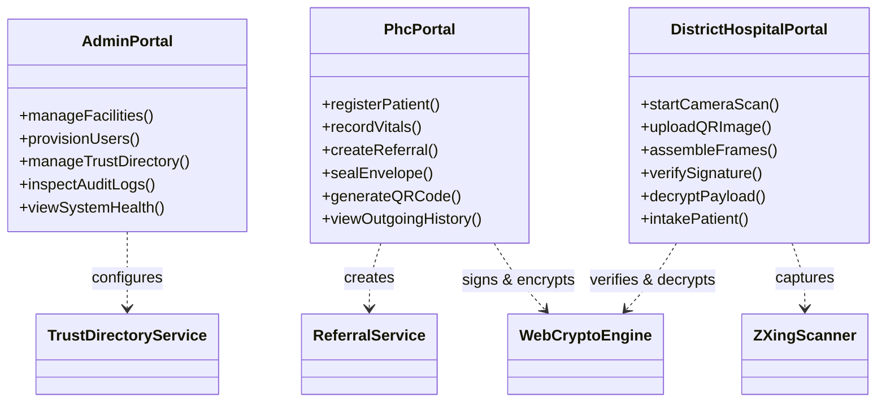
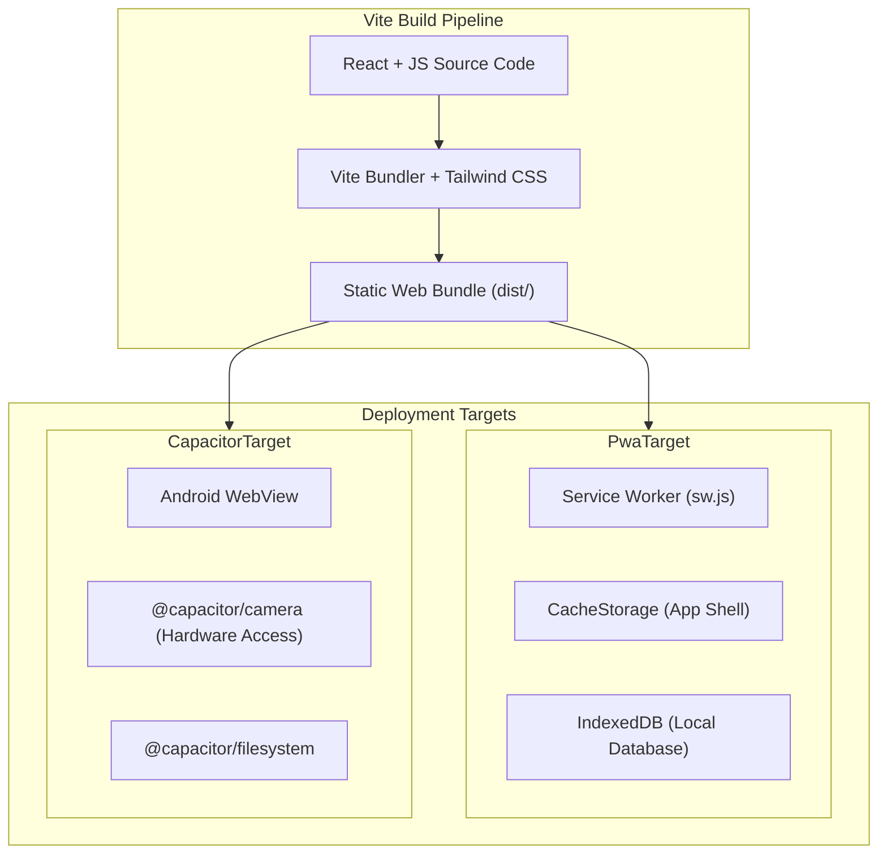

# 03. System Architecture Specification

## 1. Architectural Philosophy and Paradigms
MediLink Offline is architected as an **Offline-First, Zero-Trust, Air-Gapped Healthcare Application**. The system relies on a decentralized, asymmetric physical handoff topology rather than a client-server centralized network pipeline.

```mermaid
flowchart LR
    subgraph PHC["Primary Health Centre (Origin)"]
        P1["Clinical Referral Entry"] --> P2["Web Crypto API: AES-256-GCM + RSA-OAEP"]
        P2 --> P3["ECDSA Digital Signature (P-256)"]
        P3 --> P4["MLO1 Multi-Part QR Generator"]
    end

    subgraph AirGap["Physical Air Gap Transit"]
        P4 -->|"Optical Data Stream\n(Single or Animated QR)"| H1
    end

    subgraph Hospital["District Hospital (Destination)"]
        H1["Camera / Optical QR Scanner"] --> H2["MLO1 Frame Assembly & CRC Check"]
        H2 --> H3["ECDSA Signature Verification"]
        H3 --> H4["RSA-OAEP Key Unwrap + AES Decrypt"]
        H4 --> H5["Clinical Intake & Emergency Triage"]
    end
```

---

## 2. Multi-Layered Component Architecture

The application is structured into four strictly decoupled tiers within a single React application container:

```mermaid
flowchart TD
    subgraph PresentationTier["1. Presentation Tier (UI & Portals)"]
        AdminPortal["Admin Portal\n(Facilities, Users, Keys, Audits)"]
        PhcPortal["PHC Portal\n(Patients, Vitals, Referral, QR Gen)"]
        HospitalPortal["Hospital Portal\n(Scanner, Verification, Decryption, Triage)"]
        SharedUI["Shared UI Component Library (Tailwind CSS)\n(Modal, Buttons, QR Viewers, Alert Badges)"]
    end

    subgraph ServiceTier["2. Application Service Tier (Business Logic)"]
        AuthService["Auth & RBAC Service"]
        PatientService["Patient & Clinical Vitals Service"]
        ReferralService["Referral Workflow Engine"]
        TrustDirectoryService["Trust Directory & Key Distribution Service"]
        AuditService["Audit Logging Service"]
    end

    subgraph EngineTier["3. Engine Tier (Security & Optical Protocol)"]
        WebCryptoEngine["Web Crypto Engine\n(AES-256-GCM, RSA-OAEP, ECDSA P-256, PBKDF2)"]
        KeyStoreManager["Key Wrapping & Storage Manager"]
        QREngine["MLO1 Protocol Engine\n(Chunking, Framing, CRC32, Reassembly)"]
        ZXingScanner["Optical Ingestion Engine\n(ZXing + Capacitor Camera Bridge)"]
    end

    subgraph StorageTier["4. Storage & Platform Tier"]
        IndexedDBWrapper["IndexedDB Storage Engine\n(ACID Transactional Object Stores)"]
        ServiceWorkerEngine["PWA Service Worker\n(Cache-First Offline Shell & Assets)"]
        CapacitorBridge["Capacitor Native Runtime Bridge\n(Android Hardware & File System)"]
        OptionalSyncGateway["Optional Cloud Sync Gateway\n(Asynchronous REST/JSON Queue)"]
    end

    PresentationTier --> ServiceTier
    ServiceTier --> EngineTier
    EngineTier --> StorageTier
    ServiceTier --> StorageTier
```

### Layer Responsibilities
1. **Presentation Tier**:
   - Manages role-based portal views, view-model states, and UI interactions.
   - Enforces visual accessibility standards with high-contrast healthcare palettes.
   - Houses portal-specific workflows (`/portals/admin`, `/portals/phc`, `/portals/hospital`).
2. **Application Service Tier**:
   - Implements domain-driven healthcare business logic.
   - Handles patient intake validation, referral state transitions, permission verification, and audit event dispatching.
   - Completely agnostic of the underlying cryptographic and storage implementation details.
3. **Engine Tier (Security & Optical Protocol)**:
   - Encapsulates cryptographic operations using standard Web Crypto API primitives.
   - Formulates and decomposes the MLO1 multi-part QR protocol.
   - Interfaces directly with optical scanner hardware (ZXing video stream and canvas decoding).
4. **Storage & Platform Tier**:
   - Manages local client-side persistence in IndexedDB with transactional consistency.
   - Provides Service Worker caching strategies ensuring seamless offline execution.
   - Connects to Capacitor native plugins for hardware camera and Android APK deployment.

---

## 3. The Three Dedicated Portals

### 3.1 Portal 1: Admin Portal
- **Target Persona**: Medical Superintendent, District Health IT Officer, Administrative Coordinator.
- **Key Modules**:
  - `FacilityManager`: CRUD operations on health facilities; sets facility type, geolocation tags, and official codes.
  - `UserRbacManager`: Assigns clinical roles, initializes temporary credentials, and audits credential assignment.
  - `TrustDirectoryManager`: Generates facility keypairs; publishes trusted public key bundles; imports/exports offline key bundles (via JSON file or USB transport).
  - `AuditViewer`: Displays comprehensive, cryptographically tracked action records.

### 3.2 Portal 2: Primary Health Centre (PHC) Portal
- **Target Persona**: Medical Officer in Charge, Staff Nurse, Auxiliary Nurse Midwife (ANM).
- **Key Modules**:
  - `PatientRegistrar`: Patient identity enrollment and demographic lookup.
  - `ClinicalAssessment`: Records triage vitals (BP, SpO2, pulse, temp), allergies, medications, and physical exam findings.
  - `ReferralArchitect`: Selects destination facility, triage urgency, and referral reasoning.
  - `CryptoSealer`: Coordinates AES session key generation, envelope encryption, and ECDSA digital signing.
  - `QRTransmitter`: Renders static single QR codes or multi-part animated QR code slideshows (MLO1 format) with configurable playback speeds (1-4 FPS).

### 3.3 Portal 3: District Hospital Portal
- **Target Persona**: Emergency Triage Nurse, Casualty Medical Officer, Admitting Specialist.
- **Key Modules**:
  - `OpticalReceiver`: Camera viewfinder interface powered by ZXing, with live frame detection, flash toggle, and manual image file upload fallback.
  - `FrameReassembler`: Collects chunks, validates CRC32 per frame, tracks missing chunks, and triggers assembly when 100% complete.
  - `SecurityValidator`: Performs ECDSA signature verification against local Trust Directory; verifies AES-GCM authentication tag.
  - `DecryptionEngine`: Prompts for clinical PIN to unwrap hospital private key and decrypts referral record.
  - `TriageAdmission`: Displays full clinical history, urgent allergy warnings, medications given, and logs patient intake.

---

## 4. Platform Deployment Topology (PWA & Android Capacitor)

### Android Compatibility via Capacitor
MediLink Offline is designed to compile directly into a native Android APK:
- `@capacitor/core` and `@capacitor/cli` manage the native wrapper.
- `@capacitor/camera` provides direct hardware camera feeds, optimizing autofocus and low-light QR scanning.
- No modifications to the core business logic, Web Crypto API, or IndexedDB storage layer are required when switching between Web PWA and Native Android APK.

