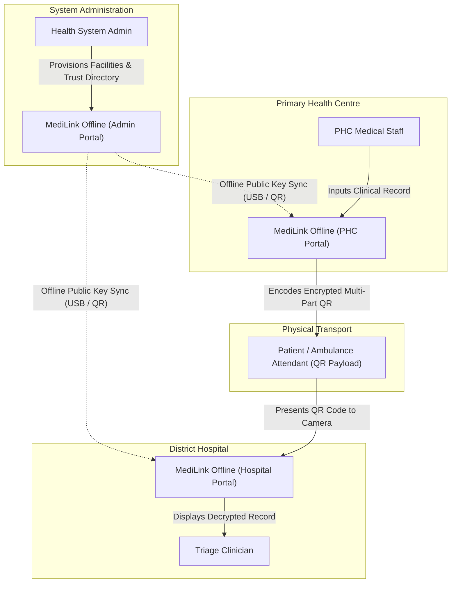
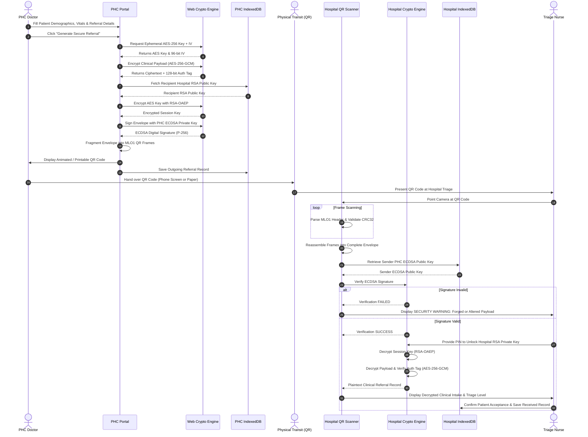

# 04. Use Cases and Data-Flow Diagrams

## 1. Primary Actors Matrix

| Actor | Category | Description | Access Rights |
|---|---|---|---|
| **System Administrator** | Administrative | Responsible for facility provisioning, role assignments, and key directory management. | Full Admin Portal Access |
| **PHC Medical Officer** | Clinical Origin | Examines patient, makes referral decisions, signs clinical records with facility key. | PHC Portal (Full Access) |
| **PHC Nurse / Staff** | Clinical Origin | Assists in patient registration, recording baseline vitals, and operating QR display. | PHC Portal (Restricted Signing) |
| **Emergency Triage Nurse** | Clinical Destination | Operates QR scanner at hospital casualty intake, validates sender authenticity. | District Hospital Portal (Triage) |
| **Admitting Physician** | Clinical Destination | Reviews decrypted medical history, confirms clinical admission, plans emergency treatment. | District Hospital Portal (Physician) |

---

## 2. Core Use-Case Specifications

### 2.1 Use Case UC-01: End-to-End Emergency Referral Creation and QR Encoding
- **Primary Actor**: PHC Medical Officer
- **Preconditions**:
  - The PHC facility profile and local private key are provisioned in IndexedDB.
  - The destination District Hospital's public key is present in the local Trust Directory.
  - The medical officer has unlocked their credentials using their authorized PIN.
- **Main Success Scenario**:
  1. Doctor navigates to PHC Portal -> "Create Referral".
  2. Doctor selects or registers the patient (`PAT-2026-00812`), enters vitals (BP 80/50, SpO2 88%, Pulse 125 bpm), diagnosis ("Acute Respiratory Distress Syndrome secondary to Pneumonia"), and medications given (IV Ceftriaxone, Nebulized Salbutamol).
  3. Doctor selects destination: "District Hospital Indore", priority: "EMERGENCY_CRITICAL".
  4. System validates all clinical fields.
  5. System generates ephemeral 256-bit AES key and 96-bit IV via `crypto.getRandomValues()`.
  6. System encrypts structured clinical JSON using AES-256-GCM.
  7. System fetches Destination Hospital's RSA-OAEP public key from local Trust Directory and encrypts the AES key.
  8. System signs the referral envelope using the PHC's ECDSA P-256 private key.
  9. System packages the payload into MLO1 protocol frames (e.g., 3 chunks of 380 bytes each) with individual CRC32 checksums.
  10. System displays the animated QR code on screen (or prints static multi-frame referral paper slip).
  11. System saves the referral record locally in IndexedDB under `referrals_outgoing` with status `DISPATCHED`.
- **Postconditions**:
  - An encrypted, tamper-evident referral payload is visually displayed as a QR stream ready for transit.

### 2.2 Use Case UC-02: QR Scanning, Signature Verification, and Decryption at District Hospital
- **Primary Actor**: Hospital Triage Nurse / Admitting Physician
- **Preconditions**:
  - The District Hospital's private key is stored in IndexedDB.
  - The sending PHC's ECDSA public key is registered in the hospital's local Trust Directory.
  - Clinician is logged in with authorized PIN.
- **Main Success Scenario**:
  1. Triage Nurse opens Hospital Portal -> "Scan Incoming Referral".
  2. Nurse points camera at the patient's smartphone screen or printed paper slip showing the MLO1 QR code.
  3. Scanner detects Frame 1/3, verifies CRC32, caches chunk.
  4. Scanner detects Frame 2/3 and 3/3 in successive frames (displaying "3 of 3 Frames Captured - 100%").
  5. System concatenates chunks and parses the `EncryptedReferralEnvelope`.
  6. System extracts `senderFacilityId` ("PHC-DHAR-04") and retrieves its public key from `trusted_keys`.
  7. System verifies the ECDSA digital signature over the ciphertext and envelope metadata. Signature is VALID.
  8. System prompts clinician for PIN to unwrap hospital private key.
  9. System decrypts AES session key using RSA-OAEP private key.
  10. System decrypts referral record using AES-256-GCM and verifies the 128-bit authentication tag. Auth tag is VALID.
  11. System renders decrypted clinical summary with highlighted CRITICAL EMERGENCY alerts.
  12. Nurse clicks "Acknowledge & Admit Patient", assigning triage bed and admitting team.
  13. System saves record into `referrals_received` store with status `ADMITTED`.
- **Alternative / Exception Flows**:
  - *Invalid CRC*: Frame discarded silently, scanner continues waiting for clean frame.
  - *Unknown Sender Public Key*: System displays warning: "UNREGISTERED SENDER. Referral cannot be authenticated. Proceed with manual verification."
  - *Signature Verification Failed*: System aborts intake with high-visibility error: "SECURITY ALERT: Digital signature mismatch. Referral payload has been altered or forged."
  - *Authentication Tag Mismatch*: System aborts: "DECRYPTION ERROR: Ciphertext corrupted. Authentication tag validation failed."

---

## 3. Detailed Data-Flow Diagrams (DFD)

### 3.1 DFD Level 0: Global Context Diagram

---

### 3.2 Sequence Diagram: Complete Cryptographic Referral Creation & Ingestion Workflow

