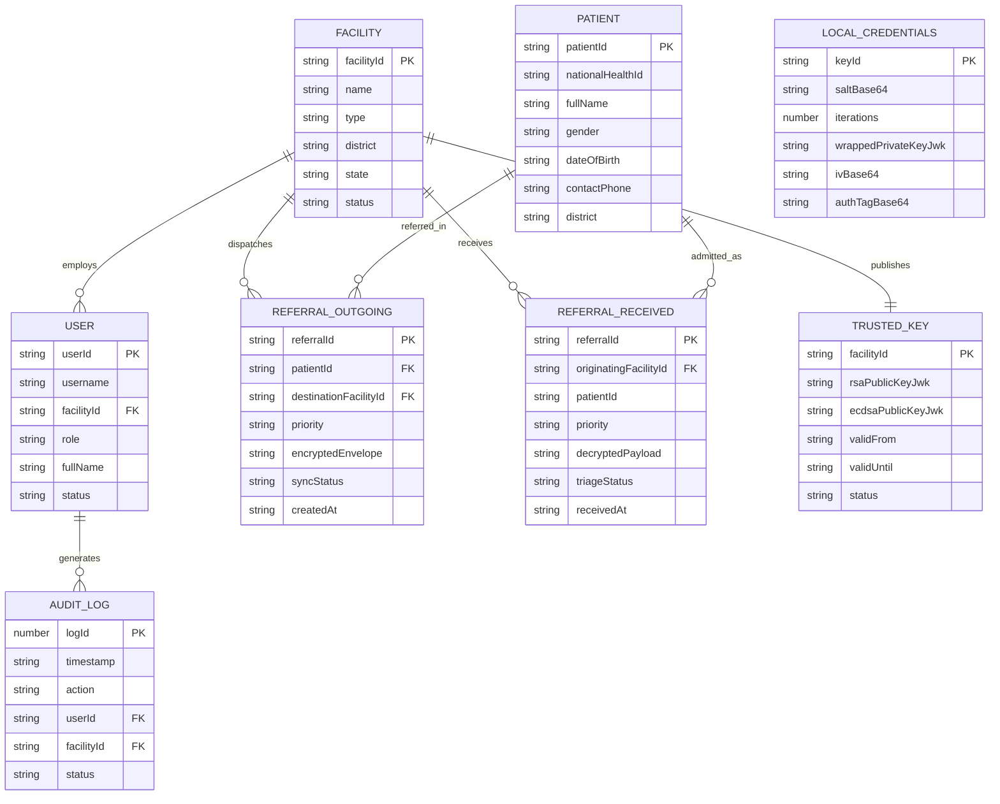

# 05. Database Design & Persistence Specification

## 1. Local Storage Strategy & IndexedDB Foundation
MediLink Offline operates 100% offline using the browser's native **IndexedDB** engine. IndexedDB provides:
- Client-side structured storage with no size constraints imposed by typical `localStorage` (5MB).
- ACID-compliant multi-store transactional guarantees, preventing database corruption during power outages or unexpected browser closures.
- B-tree indexing for rapid queries on referral priority, facility codes, and timestamps.
- Zero network round-trips for core healthcare operations.

---

## 2. Entity-Relationship Model (Logical ERD)



---

## 3. Object Store Schema Definitions

### Store 1: `facilities`
- **Primary Key**: `facilityId` (String, e.g., `"PHC-DHAR-04"`)
- **Indexes**:
  - `by_type`: Key path `type` (Unique: false)
  - `by_district`: Key path `district` (Unique: false)
  - `by_status`: Key path `status` (Unique: false)
- **Record Shape**:
```json
{
  "facilityId": "PHC-DHAR-04",
  "name": "Dhar Primary Health Centre",
  "type": "PRIMARY_HEALTH_CENTRE",
  "district": "Dhar",
  "state": "Madhya Pradesh",
  "contactNumber": "+91-7292-234567",
  "status": "ACTIVE",
  "createdAt": "2026-01-15T08:00:00.000Z"
}
```

### Store 2: `users`
- **Primary Key**: `userId` (String, e.g., `"USR-DOC-001"`)
- **Indexes**:
  - `by_facility`: Key path `facilityId` (Unique: false)
  - `by_role`: Key path `role` (Unique: false)
  - `by_username`: Key path `username` (Unique: true)
- **Record Shape**:
```json
{
  "userId": "USR-DOC-001",
  "username": "dr.sharma",
  "fullName": "Dr. Rajesh Sharma, MBBS",
  "role": "PHC_DOCTOR",
  "facilityId": "PHC-DHAR-04",
  "qualification": "Medical Officer",
  "status": "ACTIVE"
}
```

### Store 3: `trusted_keys`
- **Primary Key**: `facilityId` (String, e.g., `"DH-INDORE-01"`)
- **Indexes**:
  - `by_status`: Key path `status` (Unique: false)
  - `by_updated`: Key path `updatedAt` (Unique: false)
- **Record Shape**:
```json
{
  "facilityId": "DH-INDORE-01",
  "facilityName": "Maharaja Yeshwantrao District Hospital, Indore",
  "rsaPublicKeyJwk": {
    "kty": "RSA",
    "n": "v7F...Base64UrlModulus...",
    "e": "AQAB",
    "alg": "RSA-OAEP-256",
    "ext": true
  },
  "ecdsaPublicKeyJwk": {
    "kty": "EC",
    "crv": "P-256",
    "x": "f83ND...Base64UrlCoord...",
    "y": "Abc12...Base64UrlCoord...",
    "alg": "ES256",
    "ext": true
  },
  "status": "ACTIVE",
  "validFrom": "2026-01-01T00:00:00.000Z",
  "validUntil": "2028-01-01T00:00:00.000Z",
  "updatedAt": "2026-01-01T00:00:00.000Z"
}
```

### Store 4: `patients`
- **Primary Key**: `patientId` (String, e.g., `"PAT-2026-00812"`)
- **Indexes**:
  - `by_name`: Key path `fullName` (Unique: false)
  - `by_national_id`: Key path `nationalHealthId` (Unique: false)
  - `by_created`: Key path `createdAt` (Unique: false)
- **Record Shape**:
```json
{
  "patientId": "PAT-2026-00812",
  "nationalHealthId": "91-4567-8901-2345",
  "fullName": "Aarav Kumar",
  "gender": "MALE",
  "dateOfBirth": "1994-06-12",
  "age": 32,
  "contactPhone": "+91-9876543210",
  "addressVillage": "Mandu Road, Village Nalchha",
  "district": "Dhar",
  "guardianName": "Sunita Kumar (Wife)",
  "createdAt": "2026-11-24T10:15:00.000Z"
}
```

### Store 5: `referrals_outgoing`
- **Primary Key**: `referralId` (UUIDv4)
- **Indexes**:
  - `by_patient`: Key path `patientId` (Unique: false)
  - `by_destination`: Key path `destinationFacilityId` (Unique: false)
  - `by_priority`: Key path `priority` (Unique: false)
  - `by_created`: Key path `createdAt` (Unique: false)
  - `by_sync_status`: Key path `syncStatus` (Unique: false)
- **Record Shape**:
```json
{
  "referralId": "d3b07384-d113-49fb-a796-03f6f1c7d21a",
  "patientId": "PAT-2026-00812",
  "destinationFacilityId": "DH-INDORE-01",
  "priority": "EMERGENCY_CRITICAL",
  "plainRecordPreview": {
    "patientName": "Aarav Kumar",
    "provisionalDiagnosis": "Acute Severe Pneumonia with Respiratory Distress",
    "referralReason": "Hypoxia unresponsive to low-flow oxygen, requires ICU bed"
  },
  "encryptedEnvelope": {
    "version": "1.0",
    "referralId": "d3b07384-d113-49fb-a796-03f6f1c7d21a",
    "senderFacilityId": "PHC-DHAR-04",
    "recipientFacilityId": "DH-INDORE-01",
    "timestamp": "2026-11-24T10:30:00.000Z",
    "encryptedSessionKey": "q8fN...Base64EncryptedKey...",
    "iv": "vJ9k2LmOPq1s",
    "ciphertext": "kM98v1xL...Base64Ciphertext...",
    "authTag": "0a1b2c3d4e5f6789a0b1c2d3e4f5a6b7",
    "digitalSignature": "MEQCIG9...Base64Signature..."
  },
  "qrFramesCount": 3,
  "syncStatus": "PENDING_LOCAL",
  "createdAt": "2026-11-24T10:30:00.000Z"
}
```

### Store 6: `referrals_received`
- **Primary Key**: `referralId` (UUIDv4)
- **Indexes**:
  - `by_origin`: Key path `originatingFacilityId` (Unique: false)
  - `by_patient_name`: Key path `patientName` (Unique: false)
  - `by_priority`: Key path `priority` (Unique: false)
  - `by_received_at`: Key path `receivedAt` (Unique: false)
  - `by_triage_status`: Key path `triageStatus` (Unique: false)
- **Record Shape**:
```json
{
  "referralId": "d3b07384-d113-49fb-a796-03f6f1c7d21a",
  "originatingFacilityId": "PHC-DHAR-04",
  "originatingFacilityName": "Dhar Primary Health Centre",
  "patientName": "Aarav Kumar",
  "priority": "EMERGENCY_CRITICAL",
  "clinicalRecord": {
    "vitals": { "systolicBP": 85, "diastolicBP": 55, "heartRate": 128, "spO2": 86 },
    "medicationsGiven": [{ "name": "IV Ceftriaxone", "dose": "1g" }],
    "allergies": ["Penicillin"]
  },
  "signatureStatus": "VERIFIED_AUTHENTIC",
  "triageStatus": "ADMITTED_ICU",
  "admittingDoctor": "Dr. V. K. Mehta",
  "receivedAt": "2026-11-24T12:45:00.000Z"
}
```

### Store 7: `local_credentials`
- **Primary Key**: `keyId` (e.g., `"FACILITY_SIGNING_KEY"`, `"FACILITY_DECRYPTION_KEY"`)
- **Record Shape**:
```json
{
  "keyId": "FACILITY_SIGNING_KEY",
  "algorithm": "ECDSA-P256",
  "salt": "a7b8c9d0e1f2a3b4c5d6e7f8a9b0c1d2",
  "iterations": 100000,
  "wrappedPrivateKey": "9f8e7d...AES_GCM_Wrapped_Jwk...",
  "iv": "1a2b3c4d5e6f7a8b9c0d1e2f",
  "authTag": "f1e2d3c4b5a60718293a4b5c6d7e8f90",
  "updatedAt": "2026-01-15T08:00:00.000Z"
}
```

### Store 8: `audit_logs`
- **Primary Key**: `logId` (Auto-increment integer)
- **Indexes**:
  - `by_timestamp`: Key path `timestamp` (Unique: false)
  - `by_action`: Key path `action` (Unique: false)
  - `by_user`: Key path `userId` (Unique: false)
  - `by_facility`: Key path `facilityId` (Unique: false)

---

## 4. Transaction Management & Integrity Guarantees
- All write operations execute inside explicit readwrite IndexedDB transactions:
  ```javascript
  const tx = db.transaction([STORES.REFERRALS_OUTGOING, STORES.AUDIT_LOGS], 'readwrite');
  await tx.objectStore(STORES.REFERRALS_OUTGOING).add(referralRecord);
  await tx.objectStore(STORES.AUDIT_LOGS).add(auditRecord);
  await tx.done;
  ```
- If an exception occurs at any point (e.g., crypto failure or quota exhaustion), the transaction automatically aborts, preventing partial writes.

---

## 5. Schema Migration Strategy
When `DB_VERSION` increments:
- The `onupgradeneeded` handler checks `event.oldVersion` and applies non-destructive step migrations.
- Existing stores and data indexes are preserved; new stores or indexes are created via `db.createObjectStore()` and `store.createIndex()`.

