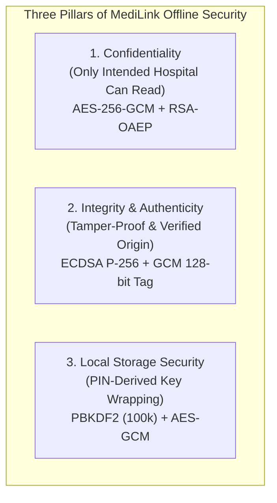
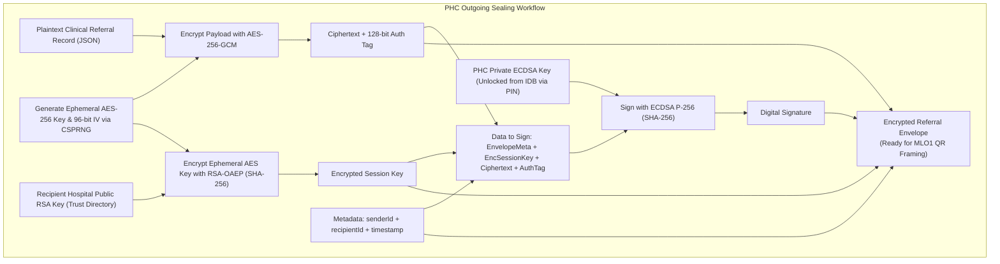
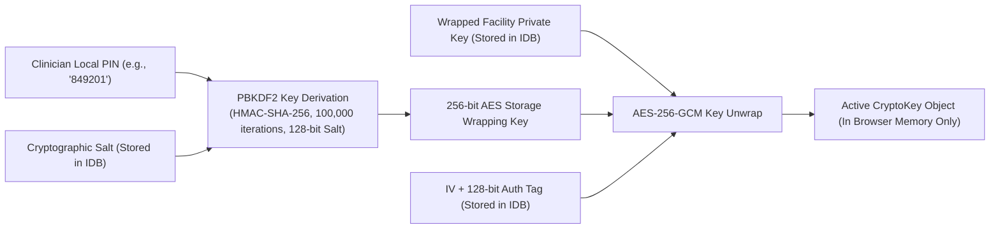
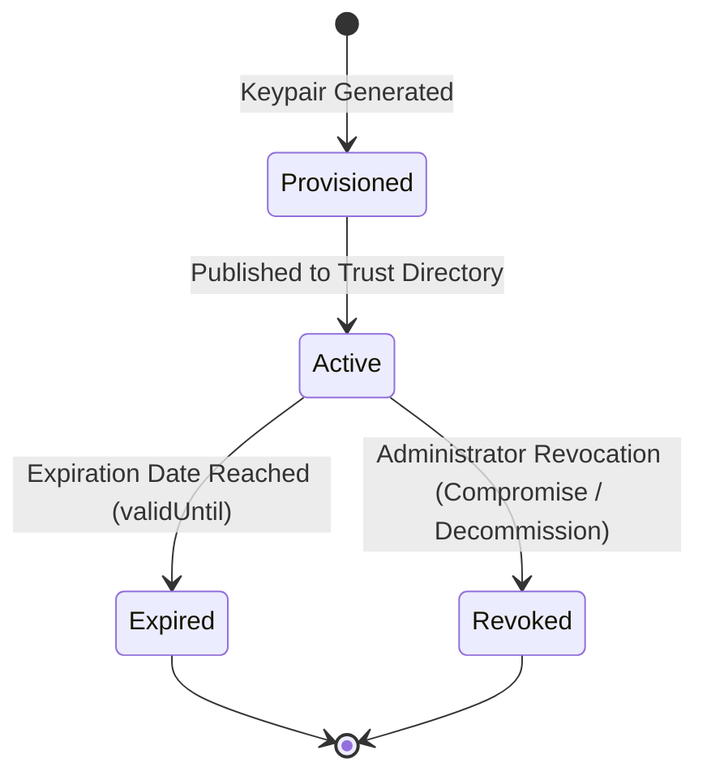

# 06. Security Architecture Specification

## 1. Zero-Trust Security Philosophy
MediLink Offline operates on the principle that the physical transport layer (patients, drivers, mobile phones, printed paper slips) is **untrusted and public**. Anyone can inspect, photograph, or copy a QR code during transit. 

Consequently, security must not rely on transport secrecy, obscure barcode encoding, or network perimeter defenses. Instead, security is mathematically guaranteed at the application data layer through **standardized client-side cryptographic primitives**.

---

## 2. Cryptographic Primitives & Specifications

All operations are executed via the W3C standard **Web Crypto API** (`window.crypto.subtle`). Custom, proprietary, or unvetted cryptographic implementations are strictly forbidden.

| Purpose | Standard Primitive | Parameter Specification | Security Property |
|---|---|---|---|
| **Content Encryption** | `AES-GCM` | 256-bit Key, 96-bit Random IV, 128-bit Authentication Tag | Authenticated Confidentiality |
| **Key Encapsulation** | `RSA-OAEP` | 2048-bit (or 4096-bit) Modulus, SHA-256 Hash, Public Exponent 65537 | Asymmetric Confidentiality |
| **Digital Signatures** | `ECDSA` | Curve NIST P-256 (`secp256r1`), SHA-256 Digest | Authenticity & Non-Repudiation |
| **PIN Key Derivation** | `PBKDF2` | HMAC-SHA-256, 100,000 Iterations, 128-bit Random Salt | Brute-force Resistance |
| **Key Wrapping at Rest**| `AES-GCM` | 256-bit Key derived from PIN, 96-bit IV, 128-bit Tag | Encrypted Storage at Rest |
| **Random Number Gen**  | `CSPRNG` | `crypto.getRandomValues()` | Cryptographic Unpredictability |

---

## 3. The Hybrid Envelope Encryption Workflow

### Encryption Protocol Details
1. **Payload Serialization**: The clinical record (demographics, vitals, clinical summary, allergies, medications) is serialized into canonical UTF-8 JSON.
2. **Ephemeral AES Key Generation**: A cryptographically random 256-bit symmetric key $K_{AES}$ and a unique 96-bit IV are generated:
   $$\text{IV} \leftarrow \text{CSPRNG}(96\text{ bits}), \quad K_{AES} \leftarrow \text{CSPRNG}(256\text{ bits})$$
3. **AES-GCM Authenticated Encryption**:
   $$C, T \leftarrow \text{AES-GCM-Encrypt}(K_{AES}, \text{IV}, \text{Plaintext})$$
   where $C$ is the ciphertext and $T$ is the 128-bit authentication tag.
4. **Asymmetric Key Encapsulation**: $K_{AES}$ is encrypted with the recipient District Hospital's RSA-OAEP public key:
   $$E_{K} \leftarrow \text{RSA-OAEP-Encrypt}(PK_{\text{Hospital}}, K_{AES}, \text{hash}=\text{SHA-256})$$
5. **Digital Signature Calculation**: An ECDSA signature $\sigma$ is computed over the entire concatenated envelope payload:
   $$M_{\text{sign}} = \text{senderFacilityId} \parallel \text{recipientFacilityId} \parallel \text{timestamp} \parallel E_{K} \parallel \text{IV} \parallel C \parallel T$$
   $$\sigma \leftarrow \text{ECDSA-Sign}(SK_{\text{PHC}}, M_{\text{sign}}, \text{curve}=\text{P-256}, \text{hash}=\text{SHA-256})$$

---

## 4. Local Credential & Private Key Protection (PIN-Based Wrapping)

### Critical Architectural Principle:
**A PIN ALONE IS NOT A KEY EXCHANGE MECHANISM.** A 4-to-6 digit PIN possesses low mathematical entropy ($\sim 13 \text{ to } 20 \text{ bits}$) and cannot directly secure public communications or encrypt patient data. 

In MediLink Offline, the PIN is utilized **exclusively for local authorization to unwrap encrypted private keys stored in the local client IndexedDB**.

### Protocol for Local Key Storage and Recovery:
1. **Key Provisioning**:
   - The device generates the facility's identity keys ($SK_{\text{ECDSA}}, PK_{\text{ECDSA}}, SK_{\text{RSA}}, PK_{\text{RSA}}$).
   - The user creates a local access PIN.
   - The system generates a fresh 128-bit salt: $S \leftarrow \text{CSPRNG}(128\text{ bits})$.
   - The PIN and salt are passed to PBKDF2 with 100,000 iterations to derive a 256-bit AES wrapping key $K_{\text{wrap}}$:
     $$K_{\text{wrap}} \leftarrow \text{PBKDF2}(\text{PIN}, S, 100000, \text{SHA-256}, 256\text{ bits})$$
   - $SK$ is exported as a JWK (JSON Web Key) and encrypted via AES-256-GCM using $K_{\text{wrap}}$:
     $$C_{\text{key}}, T_{\text{key}} \leftarrow \text{AES-GCM-Encrypt}(K_{\text{wrap}}, \text{IV}_{\text{wrap}}, \text{JWK}_{SK})$$
   - The encrypted record $\{S, \text{iterations}=100000, \text{IV}_{\text{wrap}}, C_{\text{key}}, T_{\text{key}}\}$ is persisted into IndexedDB (`local_credentials`).
   - The plaintext PIN and $K_{\text{wrap}}$ are cleared from memory.
2. **Key Unwrapping on Clinician Login**:
   - The clinician inputs the PIN.
   - The system re-derives $K_{\text{wrap}}$ using the stored salt and iteration count.
   - The system decrypts and imports the private key into a non-extractable in-memory `CryptoKey` object.
   - If the wrong PIN is entered, AES-GCM tag verification fails immediately, protecting against unauthorized access.
   - A client-side rate-limiter imposes an exponential back-off after 3 consecutive failed attempts (5s, 15s, 60s, lockout).

---

## 5. Trust Directory & Public Key Lifecycle Management

### 5.1 Public Key Directory Synchronization (Offline Air-Gap)
Since facilities have no permanent internet access, the Public Key Trust Directory must be synchronized offline:
1. **District Admin Authority**: The District Health Office publishes a master `TrustDirectory.json` bundle containing all certified facilities and their public keys.
2. **Air-Gapped Distribution**:
   - **Method A (USB Token)**: The administrative coordinator delivers an updated `TrustDirectory.json` via USB flash drive during routine supervisory visits.
   - **Method B (Master QR Code)**: An administrative public key bundle QR code can be scanned directly to update trust entries.
3. **Integrity of the Directory**: The `TrustDirectory.json` is signed by the District Administrative Authority's master signing key. The local app verifies this master signature before accepting updates.

### 5.2 Key Rotation & Revocation Planning
- **Key Expiry**: Facility keys carry a mandatory validity window (default 24 months). The application alerts administrators 60 days before expiration.
- **Revocation List**: The Trust Directory includes a `revocations` list containing `{ facilityId, revokedAt, reason }`. Incoming referrals signed by revoked keys are flagged with high-severity alerts.

---

## 6. Threat Modeling & Attack Surface Analysis

| Threat / Attack Vector | Risk Level | Mitigation in MediLink Offline Architecture |
|---|---|---|
| **Eavesdropping in Transit** (Interception of QR code by transport driver or bystander) | Critical | **Mitigated**: The entire referral payload is encrypted using AES-256-GCM. The AES session key is encrypted with the destination hospital's RSA-OAEP public key. An eavesdropper sees only random high-entropy ciphertext. |
| **Referral Forgery / Impersonation** (Malicious actor creates fake referral slip) | Critical | **Mitigated**: The referral must be signed with the sending PHC's ECDSA P-256 private key. Hospitals reject any referral that fails cryptographic signature verification against the verified Trust Directory. |
| **Payload Tampering / Bit-Flipping** (Altering dosage or diagnosis in transit) | Critical | **Mitigated**: AES-256-GCM 128-bit authentication tag and ECDSA signature both detect single-bit modifications. Tampered records fail validation instantly and are rejected. |
| **Replay Attacks** (Re-submitting an old referral code) | Medium | **Mitigated**: Every referral carries a unique UUID (`referralId`) and an ISO 8601 creation timestamp. Receiving hospitals record processed UUIDs in IndexedDB; duplicate submissions are flagged immediately. |
| **Physical Theft of Device** (Stolen PHC tablet or laptop) | High | **Mitigated**: Private keys in IndexedDB are encrypted at rest with PBKDF2 (100,000 iterations) + AES-GCM wrapping. Without the clinician's PIN, extraction yields only AES ciphertext. Non-extractable `CryptoKey` in memory is never saved to disk. |
| **Cross-Site Scripting (XSS) / Injection** | High | **Mitigated**: Strict Content Security Policy (CSP), offline PWA execution, zero dynamic `eval()`, sanitized DOM rendering with React, and isolated IndexedDB sandbox. |

