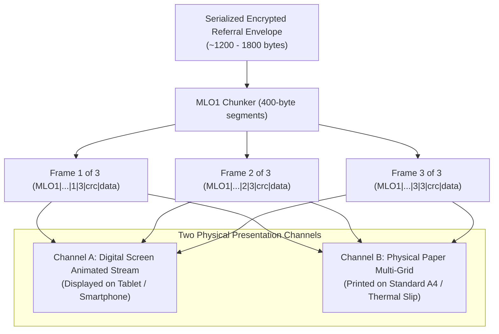
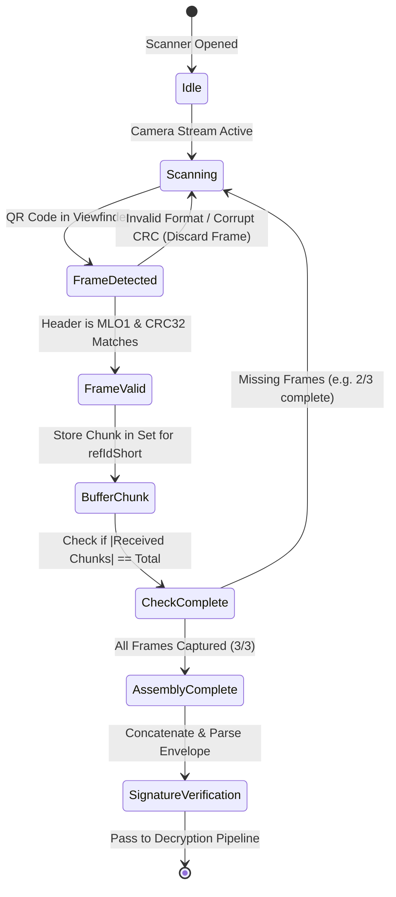

# 07. QR Transfer Protocol & Optical Ingestion Specification

## 1. Physical Layer Constraints & Barcode Physics

Standard QR codes (ISO/IEC 18004) support up to Version 40 (177x177 modules), capable in theory of holding up to 2,953 alphanumeric characters at Error Correction Level L. However, in real-world clinical and rural environments:
1. **Camera Optics & Resolution**: Budget smartphone cameras and low-cost hospital webcams struggle with dense QR codes (>Version 25) due to lens distortion, motion blur, and poor autofocus.
2. **Environmental Lighting**: Dimly lit triage casualty rooms and bright outdoor ambulance transfers create glare and contrast degradation.
3. **Screen Refresh Artifacts**: Scanning a dense QR code displayed on a low-end smartphone screen produces moiré patterns and optical interference.

To guarantee **99.9% first-pass scan success across commodity devices**, MediLink Offline specifies an optimal chunk payload size of **350–450 bytes** per frame at **Error Correction Level M (15% recovery)** or **Level L (7% recovery)**. Payloads exceeding this threshold are chunked using the **MLO1 Protocol**.

---

## 2. The MLO1 Multi-Part Framing Protocol

The MediLink Offline Protocol v1 (`MLO1`) defines a standardized frame serialization format designed for high-speed parsing and low computational overhead:

### 2.1 Frame Format Specification
```text
MLO1|<refIdShort>|<seq>|<total>|<crc32>|<chunkData>
```

| Field Name | Type | Size / Format | Description |
|---|---|---|---|
| `magic` | String | 4 chars (`"MLO1"`) | Identifies the protocol version. Frames lacking this header are ignored. |
| `refIdShort` | Hex String | 8 hex chars | First 8 characters of the referral UUID (e.g., `"d3b07384"`). Prevents interleaving frames from different referrals. |
| `seq` | Integer | 1 to $N$ | Current frame index (1-based). |
| `total` | Integer | $N$ ($1 \le N \le 30$) | Total number of frames in the complete referral sequence. |
| `crc32` | Hex String | 8 hex chars | CRC-32 checksum calculated over `chunkData`. Guarantees frame integrity before buffering. |
| `chunkData` | Base64 String | 200–450 bytes | Segment of the serialized `EncryptedReferralEnvelope` string. |

### 2.2 Concrete Example Frame
```text
MLO1|d3b07384|1|3|8a3f90b1|eyJ2ZXIiOiIxLjAiLCJyZWZJZCI6ImQzYjA3Mzg0LWQxMTMtNDlmYi1hNzk2LTAzZjZm...
```

---

## 3. QR Generation & Transmission Modes



### 3.1 Channel A: Animated Digital Slideshow (Screen-to-Camera)
- When a referral is generated on a PHC tablet or smartphone, the UI presents an animated QR carousel.
- **Playback Rate**: Cycles through frames sequentially at **2 frames per second (500 ms per frame)** or **3 FPS (333 ms per frame)**.
- At 2 FPS, a 3-frame referral transmits completely in **1.5 seconds**, and continuously loops until the receiving camera captures all missing frames.
- **Operator Controls**: The doctor or nurse can pause, advance manually, or adjust the cycle speed (1 FPS to 4 FPS).

### 3.2 Channel B: Multi-Frame Static Printout (Paper-to-Camera)
- In rural clinics equipped with basic thermal printers or office laser printers, the system renders a clean referral slip.
- The slip displays patient basic details, referral priority, and a 2x2 or 1x3 grid containing each MLO1 QR frame side by side.
- Hospital triage staff can scan each frame individually from the paper sheet in any order.

---

## 4. Camera Ingestion & Reassembly State Machine



### Reassembly Algorithm & Error Recovery
1. **Deduplication**: As the camera scans an animated screen at 15–30 FPS, it encounters the same frame multiple times. Scanned frames are stored in an in-memory `Map<refIdShort, Map<seq, data>>`. Redundant frames are instantly recognized and ignored.
2. **Out-of-Order Ingestion**: Frames do NOT need to arrive in order. If the scanner first captures Frame 2, then Frame 3, then Frame 1, it accurately buffers them.
3. **Session Isolation**: If the camera accidentally captures a frame from a different referral, `refIdShort` ensures chunks are never mixed.
4. **Visual Progress Feedback**: The triage UI renders a visual segmented bar:
   - `[ Frame 1: OK ] [ Frame 2: OK ] [ Frame 3: WAITING... ]`
   - Prominently informs the operator: *"Keep camera steady, waiting for Frame 3..."*
5. **Lossless Assembly**: Once all $N$ chunks are present:
   $$\text{EnvelopeString} = \sum_{i=1}^{N} \text{chunkData}_i$$
   The assembled string is parsed into the JSON `EncryptedReferralEnvelope`.

