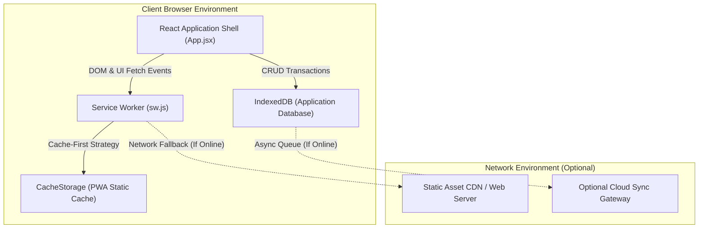
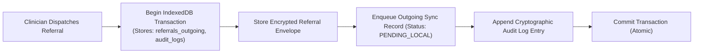

# 08. Offline & Synchronization Architecture Specification

## 1. Offline-First Architectural Mandate
In conventional web architectures, offline capabilities are treated as an afterthought or temporary fallback. For MediLink Offline, **offline is the primary, normal operating state**. 

The system operates with complete autonomy across all three portals without ever pinging an external server:
- Application code, scripts, styles, and assets are persistently available via the Service Worker cache.
- All clinical and administrative entities reside within client-side IndexedDB.
- Cryptographic keys are generated, wrapped, unlocked, and utilized entirely within browser memory and local storage.
- Data transfers between facilities occur via optical air-gapped QR codes.

---

## 2. Progressive Web Application (PWA) & Service Worker Caching



### Service Worker Caching Policy
- **Cache Strategy**: **Cache-First (Stale-While-Revalidate for updates)**.
- **Pre-Cached Assets**:
  - `index.html` (Application shell)
  - Compiled JavaScript bundles (`dist/assets/*.js`)
  - Compiled CSS stylesheets (`dist/assets/*.css`)
  - Web fonts (`Inter`, `JetBrains Mono`)
  - Manifest & clinical branding icons (`favicon.svg`, PWA icons)
- **Lifecycle Guarantees**:
  - `skipWaiting()` and `clients.claim()` are invoked on Service Worker activation, ensuring that once updated, new versions take effect seamlessly without hanging connections.
  - Zero dynamic API calls are intercepted or blocked by the Service Worker.

---

## 3. Transactional Offline Persistence

IndexedDB serves as the authoritative transactional datastore on each node:



### ACID Consistency Guarantees:
1. **Atomicity**: Either the referral, sync entry, and audit log all commit together, or none do.
2. **Consistency**: Key path integrity and index schemas are strictly enforced by the IndexedDB engine.
3. **Isolation**: Concurrent browser tabs or background service worker tasks operate within isolated transactions.
4. **Durability**: Data committed to IndexedDB survives browser restarts, power loss, and device reboots.

---

## 4. Optional Asynchronous Cloud Synchronization Gateway

While MediLink Offline requires **no server to function**, facilities that intermittently obtain cellular or broadband connectivity (e.g., when an ambulance enters cellular range or when a weekly generator-powered VSAT link connects) can synchronize telemetry with a central district health registry.

```mermaid
flowchart TD
    subgraph OfflineNode["Offline PHC / Hospital Node"]
        LocalIDB["Local IndexedDB Store"]
        SyncQueue["Sync Queue: by_sync_status = 'PENDING_LOCAL'"]
        SyncWorker["Background Sync Worker (Navigator.onLine / SyncManager)"]
    end

    subgraph CentralCloud["Optional Central Sync Gateway (Node.js / PostgreSQL)"]
        AuthMiddleware["Mutual TLS / Bearer JWT Gateway"]
        SyncEndpoint["POST /api/v1/sync/referrals"]
        PostgresDB[("PostgreSQL Master Health DB")]
    end

    LocalIDB --> SyncQueue
    SyncQueue --> SyncWorker
    SyncWorker -->|"When Online: HTTPS POST Batch"| AuthMiddleware
    AuthMiddleware --> SyncEndpoint
    SyncEndpoint --> PostgresDB
    SyncEndpoint -->>|"200 OK + Confirmed UUIDs"| SyncWorker
    SyncWorker -->|"Update syncStatus = 'SYNCED'"| LocalIDB
```

### 4.1 Sync Protocol Rules
1. **Asymmetric / Append-Only**: The sync gateway receives encrypted envelopes and audit logs. The central server does NOT need to decrypt clinical data unless authorized as a tertiary health facility.
2. **Idempotency**: All sync payloads are keyed by their immutable `referralId` (UUIDv4). Re-sending an already synchronized referral produces an HTTP 200 with no side effects.
3. **Non-Blocking Operation**: The synchronization worker operates silently in the background. If the connection drops mid-batch, the worker backs off exponentially without interrupting local clinical workflows.
4. **Conflict-Free Synchronization**: Because referrals are point-to-point and uniquely identified by UUID, merge conflicts do not occur. The originating PHC writes `referrals_outgoing`, and the receiving Hospital writes `referrals_received`. Both records represent independent, append-only events.

