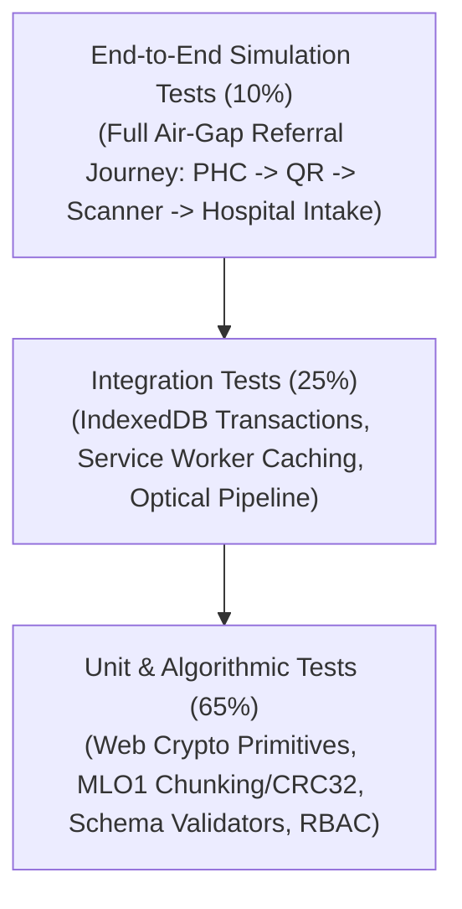

# 10. Comprehensive Testing Strategy

## 1. Testing Philosophy & Quality Engineering
Healthcare referral applications require zero margin for error. A failure in cryptographic verification or a bug in multi-part QR reassembly could delay acute emergency treatment or corrupt patient allergy data. 

MediLink Offline employs a rigorous, automated testing pyramid tailored for offline client-side architectures.

---

## 2. Test Suites Specification

### 2.1 Suite 1: Web Crypto API Cryptographic Verification (`tests/crypto/`)
- **TC-CRYPTO-01: Ephemeral Key Generation & Randomness**:
  - Verify that `crypto.getRandomValues()` produces non-repeating 256-bit AES keys and 96-bit IVs across 10,000 continuous iterations.
- **TC-CRYPTO-02: AES-256-GCM Authenticated Encryption & Decryption**:
  - Test encryption of synthetic clinical referral payloads.
  - Assert that decryption with the correct key and IV restores exact bit-for-bit plaintext JSON.
  - Assert that altering a single bit in the ciphertext or authentication tag causes decryption to throw an `OperationError` (tamper detection).
- **TC-CRYPTO-03: RSA-OAEP Key Encapsulation**:
  - Verify 2048-bit and 4096-bit RSA-OAEP encryption/decryption of 256-bit symmetric keys with SHA-256 hash.
  - Ensure wrong private keys fail decryption cleanly without uncaught exceptions.
- **TC-CRYPTO-04: ECDSA P-256 Digital Signatures**:
  - Test digital signing of referral envelopes.
  - Verify signature passes with legitimate public key.
  - Verify signature fails if sender ID, timestamp, or ciphertext is altered.
- **TC-CRYPTO-05: PBKDF2 Key Derivation & Local Key Wrapping**:
  - Verify PBKDF2 HMAC-SHA-256 derivation with 100,000 iterations.
  - Verify successful unwrapping of private key with valid PIN.
  - Verify failed unwrapping and lockout enforcement with invalid PIN.

### 2.2 Suite 2: MLO1 Multi-Part QR Protocol (`tests/qr/`)
- **TC-QR-01: Protocol Frame Chunking**:
  - Split sample referral envelopes (500 bytes, 1500 bytes, 3000 bytes) into 400-byte chunks.
  - Verify header format: `MLO1|<refId>|<seq>|<total>|<crc32>|<data>`.
- **TC-QR-02: CRC-32 Checksum Validation**:
  - Calculate CRC-32 on chunks; verify matching values.
  - Corrupt 1 byte in chunk; verify `parseFrame()` rejects the corrupted frame.
- **TC-QR-03: Out-of-Order Reassembly**:
  - Ingest frames in random sequence (e.g., Frame 3, Frame 1, Frame 2).
  - Verify that assembled payload matches original serialized envelope identically.
- **TC-QR-04: Duplicate Frame Handling**:
  - Feed identical frames repeatedly; verify buffer remains idempotent without memory leaks.

### 2.3 Suite 3: IndexedDB Persistence & Transactional ACIDity (`tests/db/`)
- **TC-IDB-01: Multi-Store Atomic Transactions**:
  - Verify simultaneous insert of referral record and audit log.
  - Simulate storage abort; verify neither record is committed.
- **TC-IDB-02: Index Query Performance**:
  - Seed 1,000 synthetic patient records; verify index search on `patientId` and `priority` returns in < 15ms.

### 2.4 Suite 4: PWA Offline Simulation & Service Worker (`tests/e2e/`)
- **TC-PWA-01: Network Offline Survival**:
  - Disconnect simulated network interface (`navigator.onLine = false`).
  - Verify application loads completely from Service Worker CacheStorage.
  - Verify patient creation, referral generation, and QR display operate with zero network requests.

---

## 3. Synthetic Test Data Guidelines
- All test suites must use **100% synthetic, fictitious patient datasets**.
- Names, addresses, and phone numbers must be generated programmatically from synthetic fixture generators (e.g., `Patient-001`, `Aarav Sharma`, `Mandu Road, Village Nalchha`, `+91-98000-00000`).
- No real patient health information (PHI) shall ever enter test fixtures or documentation.

